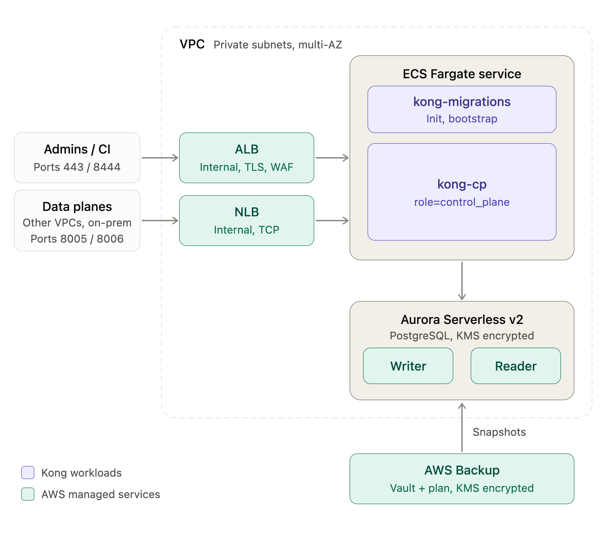

# Kong Control Plane on AWS (CDK)

AWS CDK (TypeScript) project that automates a **self-hosted Kong Gateway Enterprise control plane** on AWS:

- **ECS Fargate** runs the Kong control plane (`role=control_plane`, no proxy listener)
- **Aurora Serverless v2 (PostgreSQL)** is the Kong database
- **AWS Backup** protects the database (backups every 4 hours by default, optional weekly/monthly and cross-region copy)
- **Internal ALB** serves Kong Manager and the Admin API; **internal NLB** serves the data plane cluster/telemetry ports
- Optional WAF, VPC Flow Logs, Transit Gateway attachment and central CloudWatch log forwarding

> **Scope:** this project deploys the control plane only. Data planes are deployed separately
> (see [Connecting data planes](docs/ARCHITECTURE.md#connecting-data-planes)).

## Architecture



*Admins and CI reach the ALB (ports 443 and 8444); data planes from other VPCs or on-premises reach the NLB (ports 8005 and 8006). The ECS Fargate service runs `kong-migrations` (init, bootstrap) and `kong-cp` (`role=control_plane`) against an Aurora Serverless v2 PostgreSQL cluster, which AWS Backup snapshots into an encrypted vault.*

Three stacks per environment, deployed in dependency order:

| Stack | Contents | Lifecycle |
|---|---|---|
| `kong-cp-network-stack-{env}` | VPC, NAT, flow logs, VPC endpoints, optional Transit Gateway | Rarely changes |
| `kong-cp-database-stack-{env}` | Aurora Serverless v2, AWS Backup vault/plan/selection, generated admin secrets, KMS keys | **Stateful** – termination protection on by default |
| `kong-cp-service-stack-{env}` | ECS cluster/service, ALB, NLB, WAF, ACM certificate, DNS, log forwarding | Stateless – safe to replace |

See [docs/ARCHITECTURE.md](docs/ARCHITECTURE.md) for details.

## Prerequisites

- Node.js 20+ and npm
- AWS CLI v2 with credentials for the target account; account/region [bootstrapped](https://docs.aws.amazon.com/cdk/v2/guide/bootstrapping.html) for CDK
- A Kong Enterprise **license** (JSON) and a Kong Gateway **image** reachable from the VPC (ECR recommended)
- An ACM certificate for the ALB, or a Route 53 hosted zone so CDK can request one
- `openssl` and `jq` (used by `scripts/create-cp-secrets.sh`), and `curl` (used by `scripts/fetch-rds-ca.sh`)

## Quick start

```bash
npm install

# 1. Create the license + cluster certificate secrets (prints the ARNs)
./scripts/create-cp-secrets.sh dev ./license.json ap-southeast-2

# 2. Fetch the RDS CA bundle Kong uses to verify Aurora (commit certs/ - it is public)
./scripts/fetch-rds-ca.sh ap-southeast-2

# 3. Configure the environment
cp config/dev.json.example config/dev.json   # edit: image, secret ARNs, domain, CIDRs

# 4. Deploy
ENVIRONMENT=dev npx cdk synth
ENVIRONMENT=dev npx cdk deploy --all
```

The full walkthrough, including first login, is in [docs/DEPLOYMENT_GUIDE.md](docs/DEPLOYMENT_GUIDE.md).

## Configuration

Precedence (highest first): `config/{environment}.json` → `cdk.context.json` / `--context` → environment variables.
`ENVIRONMENT` is always required and selects the config file. Booleans are `"true"`/`"false"`; lists are comma-separated.

### Required

| Config key | Env var | Description |
|---|---|---|
| `kongImageUri` | `KONG_IMAGE_URI` | Kong Gateway Enterprise image (pin an explicit version) |
| `kongLicenseSecretArn` | `KONG_LICENSE_SECRET_ARN` | Complete ARN (with suffix) of the secret holding the license |
| `clusterCertSecretArn` | `CLUSTER_CERT_SECRET_ARN` | Complete ARN of the secret with `cluster_cert` / `cluster_cert_key` |
| `albCertificateArn` **or** `albDomain` | `ALB_CERTIFICATE_ARN` / `ALB_DOMAIN` | Existing ACM certificate, or domain for a new DNS-validated one |

### Control plane

| Config key | Default | Description |
|---|---|---|
| `cpCpu` / `cpMemory` | `1024` / `2048` | Fargate task size |
| `cpReplicas` | `2` | Number of control plane tasks |
| `cpLogLevel` | `notice` | `KONG_LOG_LEVEL` |
| `dbCaBundlePath` | `certs/rds-ca-{region}.pem` | RDS CA bundle (PEM) Kong uses to verify Aurora; create it with `scripts/fetch-rds-ca.sh` |
| `logRetentionDays` | `30` | CloudWatch retention for control plane logs |
| `dataPlaneCidrs` | VPC CIDR | CIDRs allowed to reach ports 8005/8006 (add data plane networks) |
| `clusterDomain` | – | DNS name aliased to the NLB (needs `albHostedZoneId`/`albHostedZoneName`) |

### Aurora Serverless v2

| Config key | Default | Description |
|---|---|---|
| `dbEngineVersion` | `16.13` | Aurora PostgreSQL version – confirm it against the Kong version's support matrix |
| `dbMinCapacityAcu` / `dbMaxCapacityAcu` | `0.5` / `4` | Serverless v2 capacity range (ACUs) |
| `dbReaderCount` | `1` | Serverless v2 reader instances (`0` = writer only; a reader gives Multi-AZ failover) |
| `dbBackupRetentionDays` | `14` | Aurora native automated backups / point-in-time recovery window |
| `dbPreferredBackupWindow`, `dbPreferredMaintenanceWindow` | AWS default | UTC windows |
| `dbDeletionProtection` | `true` | Also enables CloudFormation termination protection on the database stack |
| `dbSnapshotIdentifier` | – | Restore the cluster from a snapshot / AWS Backup recovery point ([details](docs/BACKUP_AND_RECOVERY.md#restore)) |

### AWS Backup

| Config key | Default | Description |
|---|---|---|
| `backupEnabled` | `true` | Create the vault, plan and Aurora selection |
| `backupIntervalHours` | `4` | How often the primary rule runs; must divide 24 (1, 2, 3, 4, 6, 8, 12, 24) |
| `backupRetentionDays` | `35` | Retention of the primary rule's recovery points |
| `backupWeeklyRetentionDays` | `0` (off) | Weekly rule (Sundays); `0` disables |
| `backupMonthlyRetentionDays` | `0` (off) | Monthly rule (1st of month); `0` disables |
| `backupStartHourUtc` | `16` | Anchor hour, UTC (`16` = 00:00 AWST); the interval repeats from it (4h -> 00, 04, 08, 12, 16, 20 UTC) |
| `backupCopyToVaultArn` | – | Existing vault (other region/account) to copy every recovery point to |

### Network, ALB, WAF, logging

| Config key | Default | Description |
|---|---|---|
| `vpcCidr`, `vpcMaxAzs`, `vpcNatGateways` | `10.0.0.0/16`, `2`, `1` | VPC shape |
| `vpcEnableFlowLogs`, `vpcEnableEndpoints` | `true`, `true` | Flow logs; ECR/Logs/Secrets Manager/S3 endpoints |
| `transitGatewayId`, `transitGatewayRoutes` | – | Attach to a Transit Gateway and route CIDRs through it |
| `albAllowedCidrs` | VPC CIDR | CIDRs allowed to reach Manager (443) and Admin API (8444) |
| `albInternetFacing` | `false` | Keep `false` – the Admin API should not be public |
| `albEnableAccessLogs` | `true` | ALB access logs to S3 (30-day expiry) |
| `albDomain`, `albHostedZoneId`, `albHostedZoneName`, `albSubjectAlternativeNames` | – | Certificate and Route 53 alias |
| `wafEnabled`, `wafRateLimit`, `wafAllowedCidrs`, `wafEnableCidrRestriction` | `true`, `2000`, –, `false` | See [docs/WAF_CONFIGURATION.md](docs/WAF_CONFIGURATION.md) |
| `loggingEnabled`, `loggingCentralDestinationArn`, `loggingFilterPattern` | `true`, –, – | See [docs/LOGGING_SETUP.md](docs/LOGGING_SETUP.md) |
| `qualifier` | – | Custom CDK bootstrap qualifier |

## Commands

```bash
npm run build          # Compile TypeScript
npm test               # Jest tests (CDK assertions)
npx cdk synth          # Generate CloudFormation
npx cdk diff           # Show pending changes
npx cdk deploy --all   # Deploy network -> database -> service
```

## Documentation

| Document | Contents |
|---|---|
| [docs/OVERVIEW.md](docs/OVERVIEW.md) | One-page summary of key features, status and limits (shareable) |
| [docs/ARCHITECTURE.md](docs/ARCHITECTURE.md) | Components, ports, security model, connecting data planes |
| [docs/DEPLOYMENT_GUIDE.md](docs/DEPLOYMENT_GUIDE.md) | Step-by-step deployment, first login, upgrades, teardown |
| [docs/BACKUP_AND_RECOVERY.md](docs/BACKUP_AND_RECOVERY.md) | AWS Backup plan, restore and DR runbook |
| [docs/NAMING_CONVENTIONS.md](docs/NAMING_CONVENTIONS.md) | Resource and stack naming |
| [docs/WAF_CONFIGURATION.md](docs/WAF_CONFIGURATION.md) | WAF on the ALB |
| [docs/LOGGING_SETUP.md](docs/LOGGING_SETUP.md) | CloudWatch logs and central forwarding |
| [config/README.md](config/README.md), [scripts/README.md](scripts/README.md) | Config files and helper scripts |
